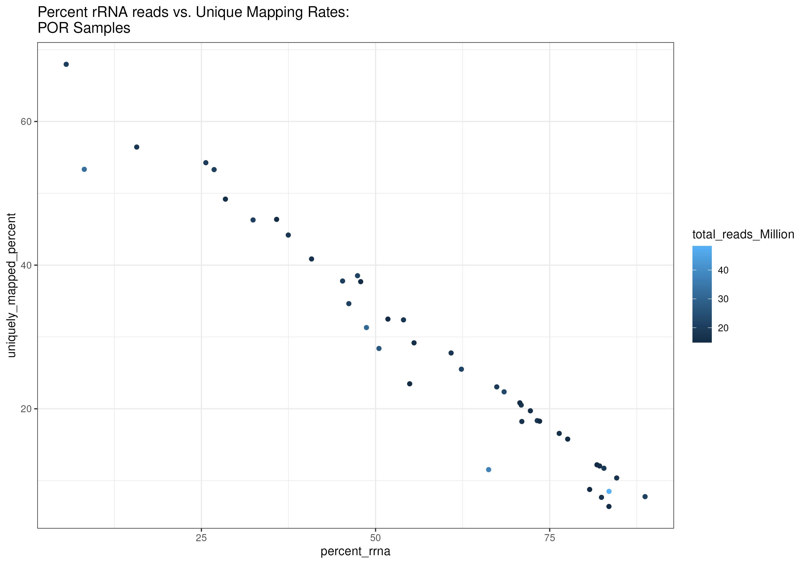

# Side Quests

The below code/work was removed from my 4-multi-species/scripts/README.md pipeline doc for clarity, since these will be referenced in the paper but the final count matrices used in the analyses were not affected/changed based on the below contamination screens/rRNA removal/etc. These were done as checks and are here for reference.

- [Symbiont genomes](#symbiont-genomes)
  - [Cgoreaui\_V2 Genome (*Cladocopium goreaui*)](#cgoreaui_v2-genome-cladocopium-goreaui)
  - [Dtrenchii Genome (*Durusdinium trenchii*, CCMP2556 isolate)](#dtrenchii-genome-durusdinium-trenchii-ccmp2556-isolate)
  - [To add: a breviolum and a symbiodinium](#to-add-a-breviolum-and-a-symbiodinium)
  - [Then align](#then-align)
    - [Run STAR as follows:](#run-star-as-follows)
    - [All 3 coral species \> Cgoreaui\_V2 Genome](#all-3-coral-species--cgoreaui_v2-genome)
    - [All 3 coral species \> Dtrenchii Genome](#all-3-coral-species--dtrenchii-genome)
  - [Assess mapping: run multiQC on the STAR alignment reports performed above](#assess-mapping-run-multiqc-on-the-star-alignment-reports-performed-above)
- [Contamination screen for poorly mapped samples](#contamination-screen-for-poorly-mapped-samples)
  - [Script: 09\_kraken.sh](#script-09_krakensh)
  - [Contamination screen results](#contamination-screen-results)
    - [MON\_R72\_H1](#mon_r72_h1)
    - [MON\_R72\_H2](#mon_r72_h2)
    - [run-2-MON\_R72\_H2](#run-2-mon_r72_h2)
    - [GOOD sample example: MON\_R72\_H3](#good-sample-example-mon_r72_h3)
    - [GOOD sample example: run-2-MON\_R72\_H3](#good-sample-example-run-2-mon_r72_h3)
- [rRNA contamination screen](#rrna-contamination-screen)
  - [First attempts: species-specific](#first-attempts-species-specific)
    - [Porites](#porites)
    - [POC rRNA contamination screen](#poc-rrna-contamination-screen)
    - [MON rRNA contamination screen](#mon-rrna-contamination-screen)
  - [species agnostic rRNA screen](#species-agnostic-rrna-screen)
    - [Script: 11\_bbduk\_rRNA\_SILVA.sh](#script-11_bbduk_rrna_silvash)
    - [Then, compile the results:](#then-compile-the-results)
    - [Post-rRNA Removal Alignment with STAR](#post-rrna-removal-alignment-with-star)
    - [First, write a general alignment script](#first-write-a-general-alignment-script)
    - [Assess Mapping Quality](#assess-mapping-quality)
    - [Run script on the alignments performed above](#run-script-on-the-alignments-performed-above)
    - [Assembly with stringtie](#assembly-with-stringtie)
  - [rRNA-free Gene count matrices](#rrna-free-gene-count-matrices)
- [SNP Calling](#snp-calling)
  - [DIY](#diy)
  - [First trying nf core pipeline](#first-trying-nf-core-pipeline)


## Symbiont genomes

I will also align all the samples to symbiont references and assess whether we should examine symbiont gene expression as well.

### Cgoreaui_V2 Genome ([*Cladocopium goreaui*](https://www.ncbi.nlm.nih.gov/datasets/genome/GCA_947184155.2/))
  - `wget https://ftp.ncbi.nlm.nih.gov/genomes/all/GCA/947/184/155/GCA_947184155.2_Cgoreaui_SCF055-01_v2.1/GCA_947184155.2_Cgoreaui_SCF055-01_v2.1_genomic.fna.gz`
  - Unity location: `/work/pi_hputnam_uri_edu/Dinos/Cgoreaui_V2.fasta`

### Dtrenchii Genome ([*Durusdinium trenchii*, CCMP2556 isolate](https://www.ncbi.nlm.nih.gov/datasets/genome/GCA_963970005.1/))
  - `wget https://ftp.ncbi.nlm.nih.gov/genomes/all/GCA/963/970/005/GCA_963970005.1_Durusdinium_trenchii_CCMP2556/GCA_963970005.1_Durusdinium_trenchii_CCMP2556_genomic.fna.gz`
  - Unity location: `/work/pi_hputnam_uri_edu/Dinos/Dtrenchii.fasta`

### To add: a breviolum and a symbiodinium

```
cd /work/pi_hputnam_uri_edu/Dinos

# 1 - Cladocopium goreaui Cgoreaui_SCF055-01_v2.1, assembled by Chen et al., 2022 https://doi.org/10.3390/microorganisms10081662

wget https://ftp.ncbi.nlm.nih.gov/genomes/all/GCA/947/184/155/GCA_947184155.2_Cgoreaui_SCF055-01_v2.1/GCA_947184155.2_Cgoreaui_SCF055-01_v2.1_genomic.fna.gz
wget https://ftp.ncbi.nlm.nih.gov/genomes/all/GCA/947/184/155/GCA_947184155.2_Cgoreaui_SCF055-01_v2.1/GCA_947184155.2_Cgoreaui_SCF055-01_v2.1_genomic.gtf.gz

mv GCA_947184155.2_Cgoreaui_SCF055-01_v2.1_genomic.fna.gz Cgoreaui_V2.fasta.gz
mv GCA_947184155.2_Cgoreaui_SCF055-01_v2.1_genomic.gtf.gz Cgoreaui_V2.gtf.gz

# 2 - Durusdinium trenchii CCMP2556 isolate, assembled by Dougan et al., 2024 https://doi.org/10.1126/sciadv.adn2218

wget https://ftp.ncbi.nlm.nih.gov/genomes/all/GCA/963/970/005/GCA_963970005.1_Durusdinium_trenchii_CCMP2556/GCA_963970005.1_Durusdinium_trenchii_CCMP2556_genomic.fna.gz
wget https://ftp.ncbi.nlm.nih.gov/genomes/all/GCA/963/970/005/GCA_963970005.1_Durusdinium_trenchii_CCMP2556/GCA_963970005.1_Durusdinium_trenchii_CCMP2556_genomic.gtf.gz

mv GCA_963970005.1_Durusdinium_trenchii_CCMP2556_genomic.fna.gz Dtrenchii.fasta.gz
mv GCA_963970005.1_Durusdinium_trenchii_CCMP2556_genomic.gtf.gz Dtrenchii.gtf.gz

gunzip *.gz

#filter GTFs to remove lines with blank transcript IDs
grep -v 'transcript_id ""' Dtrenchii.gtf > Dtrenchii_filtered.gtf
grep -v 'transcript_id ""' Cgoreaui_V2.gtf > Cgoreaui_V2_filtered.gtf

# load modules needed
module load gffread/0.12.7

# -E : remove any "non-transcript features and optional attributes"
gffread -E Dtrenchii_filtered.gtf -T -o Dtrenchii_cleaned.gtf
gffread -E Cgoreaui_V2_filtered.gtf -T -o Cgoreaui_V2_cleaned.gtf

rm *filtered.gtf
```

### Then align

I am using [STAR](https://github.com/alexdobin/STAR) for alignment, manual is [here](https://github.com/alexdobin/STAR/blob/master/doc/STARmanual.pdf)

####  Run STAR as follows:

```
# run STAR standard script
sbatch 05_STAR.sh "$species" "$genome" "$genome_path" "$gff_path" T/F
```

#### All 3 coral species > Cgoreaui_V2 Genome

```
cd /project/pi_hputnam_uri_edu/zdellaert/TimeSeries/4-multi-species/scripts

sbatch 05_STAR.sh MON Cgoreaui_V2 \
     "/work/pi_hputnam_uri_edu/Dinos/Cgoreaui_V2.fasta" \
     "/work/pi_hputnam_uri_edu/Dinos/Cgoreaui_V2.gtf" \
     T

sbatch 05_STAR.sh POC Cgoreaui_V2 \
     "/work/pi_hputnam_uri_edu/Dinos/Cgoreaui_V2.fasta" \
     "/work/pi_hputnam_uri_edu/Dinos/Cgoreaui_V2.gtf" \
     F

sbatch 05_STAR.sh POR Cgoreaui_V2 \
     "/work/pi_hputnam_uri_edu/Dinos/Cgoreaui_V2.fasta" \
     "/work/pi_hputnam_uri_edu/Dinos/Cgoreaui_V2.gtf" \
     F
```

#### All 3 coral species > Dtrenchii Genome

```
cd /project/pi_hputnam_uri_edu/zdellaert/TimeSeries/4-multi-species/scripts

sbatch 05_STAR.sh MON Dtrenchii \
     "/work/pi_hputnam_uri_edu/Dinos/Dtrenchii.fasta" \
     "/work/pi_hputnam_uri_edu/Dinos/Dtrenchii.gtf" \
     T

sbatch 05_STAR.sh POC Dtrenchii \
     "/work/pi_hputnam_uri_edu/Dinos/Dtrenchii.fasta" \
     "/work/pi_hputnam_uri_edu/Dinos/Dtrenchii.gtf" \
     F

sbatch 05_STAR.sh POR Dtrenchii \
     "/work/pi_hputnam_uri_edu/Dinos/Dtrenchii.fasta" \
     "/work/pi_hputnam_uri_edu/Dinos/Dtrenchii.gtf" \
     F
```

### Assess mapping: run multiQC on the STAR alignment reports performed above

Then:

```
# load modules needed for multiqc
module purge
module load uri/main
module load MultiQC/1.12-foss-2021b

scratch_dir="/scratch4/workspace/zdellaert_uri_edu-shared_TimeSeries/TimeSeries"

species="MON"
genome="Cgoreaui_V2"
alignments_dir="${scratch_dir}/aligned/${species}_${genome}"
qc_dir="/project/pi_hputnam_uri_edu/zdellaert/TimeSeries/4-multi-species/output_RNA/alignment_qc/${species}_${genome}"

cd "${qc_dir}"

multiqc . "${alignments_dir}"

genome="Dtrenchii"
alignments_dir="${scratch_dir}/aligned/${species}_${genome}"
qc_dir="/project/pi_hputnam_uri_edu/zdellaert/TimeSeries/4-multi-species/output_RNA/alignment_qc/${species}_${genome}"

cd "${qc_dir}"

multiqc . "${alignments_dir}"

species="POC"
genome="Cgoreaui_V2"
alignments_dir="${scratch_dir}/aligned/${species}_${genome}"
qc_dir="/project/pi_hputnam_uri_edu/zdellaert/TimeSeries/4-multi-species/output_RNA/alignment_qc/${species}_${genome}"

cd "${qc_dir}"

multiqc . "${alignments_dir}"

genome="Dtrenchii"
alignments_dir="${scratch_dir}/aligned/${species}_${genome}"
qc_dir="/project/pi_hputnam_uri_edu/zdellaert/TimeSeries/4-multi-species/output_RNA/alignment_qc/${species}_${genome}"

cd "${qc_dir}"

multiqc . "${alignments_dir}"

species="POR"
genome="Cgoreaui_V2"
alignments_dir="${scratch_dir}/aligned/${species}_${genome}"
qc_dir="/project/pi_hputnam_uri_edu/zdellaert/TimeSeries/4-multi-species/output_RNA/alignment_qc/${species}_${genome}"

cd "${qc_dir}"

multiqc . "${alignments_dir}"

genome="Dtrenchii"
alignments_dir="${scratch_dir}/aligned/${species}_${genome}"
qc_dir="/project/pi_hputnam_uri_edu/zdellaert/TimeSeries/4-multi-species/output_RNA/alignment_qc/${species}_${genome}"

cd "${qc_dir}"

multiqc . "${alignments_dir}"
```


## Contamination screen for poorly mapped samples

I am going to use [kraken](https://github.com/DerrickWood/kraken2) to screen for contaminants in files that are mapping poorly.

```
cd /project/pi_hputnam_uri_edu/zdellaert/TimeSeries/4-multi-species/scripts
nano 09_kraken.sh

#enter text in next code chunk
```

### Script: 09_kraken.sh

```
#!/usr/bin/env bash
#SBATCH --nodes=1
#SBATCH --ntasks=1
#SBATCH --cpus-per-task=16
#SBATCH --no-requeue
#SBATCH --mem=200GB
#SBATCH -t 03:59:00 --qos=short
#SBATCH --mail-type=END,FAIL,TIME_LIMIT_80
#SBATCH --error=../scripts/outs_errs/%x_error.%j #if your job fails, the error report will be put in this file
#SBATCH --output=../scripts/outs_errs/%x_output.%j #once your job is completed, any final job report comments will be put in this file

# load modules required
module load kraken2/2.1.2

# make and enter output directory
scratch_dir="/scratch4/workspace/zdellaert_uri_edu-shared_TimeSeries/TimeSeries"
data_dir="${scratch_dir}/trimmed/combined_files/"
out_dir="${scratch_dir}/kraken"

mkdir -p "${out_dir}"

trimmed=( "${data_dir}"*"R1_trim.fastq.gz" )

for R1_file in "${trimmed[@]}"; do
  # extract sample name
  sample_name=$(basename "${R1_file}" "_R1_trim.fastq.gz")

  # define R2 file
  R2_file="${data_dir}${sample_name}_R2_trim.fastq.gz"

  kraken2 \
    --db /datasets/bio/kraken2/kraken2-db/ \
    --threads 16 \
    --paired "$R1_file" "$R2_file" \
    --use-names \
    --report "${out_dir}/${sample_name}.report.txt" \
    --output "${out_dir}/${sample_name}.kraken"
done
```

Then, compile the results:

```
mkdir /project/pi_hputnam_uri_edu/zdellaert/TimeSeries/4-multi-species/output_RNA/contam_screen/
echo "sample,classification,percent_reads" > /project/pi_hputnam_uri_edu/zdellaert/TimeSeries/4-multi-species/output_RNA/contam_screen/contamination_kraken.csv

cd /scratch4/workspace/zdellaert_uri_edu-shared_TimeSeries/TimeSeries/kraken/

for f in *.report.txt; do
    sample=$(basename "$f" .report.txt)

    # Print percent in first row and first column
    top_percent=$(awk 'NR==1 {print $1}' "$f")

    # Print classification of the top contaminant (almost always unclassified) in first row and first column
    top_class=$(awk 'NR==1 {print $6}' "$f")

    echo "${sample},${top_class},${top_percent}" >> /project/pi_hputnam_uri_edu/zdellaert/TimeSeries/4-multi-species/output_RNA/contam_screen/contamination_kraken.csv

    # Print percent in fourth row and first column
    bac_percent=$(awk 'NR==4 {print $1}' "$f")

    # Print classification of the second top contaminant (almost always Bacteria) in fourth row and first column
    bac_class=$(awk 'NR==4 {print $5}' "$f")

    echo "${sample},${bac_class},${bac_percent}" >> /project/pi_hputnam_uri_edu/zdellaert/TimeSeries/4-multi-species/output_RNA/contam_screen/contamination_kraken.csv
done
```

### Contamination screen results

Coral reads will show up as unclassified, because they are not in the kraken database. Samples MON_R72_H1 and MON_R72_H2 showed 10-30% bacterial contamination, which is extremely high compared to the 2% seen in a sample that mapped well.

I am running these samples in particular because they showed 0.5% mapping, while all the other MON samples had > 70% mapping rates.

#### MON_R72_H1

- **89.0% unclassified**  
- **10.6% bacterial**  
  - 4.9% Pseudomonadota  
  - 3.9% Gammaproteobacteria  
  - 1.1% Alteromonadales

#### MON_R72_H2

- **67.5% unclassified**  
- **32.0% bacterial**  
  - 20.8% Pseudomonadota  
  - 17.9% Gammaproteobacteria  
  - 10.9% Alteromonadales

#### run-2-MON_R72_H2

- **64.7% unclassified**  
- **34.8% bacterial**  
  - 22.8% Pseudomonadota  
  - 19.8% Gammaproteobacteria  
  - 11.6% Alteromonadales

#### GOOD sample example: MON_R72_H3

- **97.8% unclassified**  
- **1.99% bacterial**  
  - 0.67% Terrabacteria  
  - 0.33% Bacillota

#### GOOD sample example: run-2-MON_R72_H3

- **97.5% unclassified**  
- **2.3% bacterial**  
  - 0.74% Terrabacteria  
  - 0.40% Bacillota

## rRNA contamination screen

### First attempts: species-specific

#### Porites

I identified the following sequences to screen for *Porites* rRNA sequences, based on BLAST results from overrepresented sequences in 

- PREDICTED: Porites lutea large subunit ribosomal RNA (LOC140953427), rRNA
  - NCBI Reference Sequence: XR_012167455.1
- PREDICTED: Porites lutea large subunit ribosomal RNA (LOC140925451), rRNA
  - NCBI Reference Sequence: XR_012164410.1
- PREDICTED: Porites lutea large subunit ribosomal RNA (LOC140953428), rRNA
  - NCBI Reference Sequence: XR_012167456.1
- PREDICTED: Porites lutea large subunit ribosomal RNA (LOC140925447), rRNA
  - NCBI Reference Sequence: XR_012164406.1
- PREDICTED: Porites lutea small subunit ribosomal RNA (LOC140925449), rRNA
  - NCBI Reference Sequence: XR_012164408.1
- PREDICTED: Porites lutea small subunit ribosomal RNA (LOC140953426), rRNA
  - NCBI Reference Sequence: XR_012167454.1

Combine these sequences:

```
cd /scratch4/workspace/zdellaert_uri_edu-shared_TimeSeries/TimeSeries/references/
nano Plutea_rRNA.txt
```

```
XR_012167455.1
XR_012164410.1
XR_012167456.1
XR_012164406.1
XR_012164408.1
XR_012167454.1
```

Then, run the following accession script to gather the sequences into a fasta file.

```
# Read the input file line by line and fetch FASTA sequences
while read -r accession; do
  if [[ -n "$accession" ]]; then
    echo "Fetching $accession..."
    curl -s "https://eutils.ncbi.nlm.nih.gov/entrez/eutils/efetch.fcgi?db=nuccore&id=${accession}&rettype=fasta&retmode=text" >> "Plutea_rRNA.fasta"
    echo >> "Plutea_rRNA.fasta"  # Add a newline between sequences
    sleep 1  # Avoid hitting rate limits
  fi
done < "Plutea_rRNA.txt"
```

```
cd /project/pi_hputnam_uri_edu/zdellaert/TimeSeries/4-multi-species/scripts
nano 011_bbduk_rRNA.sh

#enter text in next code chunk
```

##### Script: 011_bbduk_rRNA.sh

```
#!/usr/bin/env bash
#SBATCH --export=NONE
#SBATCH --ntasks=1 --cpus-per-task=4
#SBATCH --mem=16GB
#SBATCH -t 03:59:00
#SBATCH --array=0-41
#SBATCH --error=../scripts/outs_errs/%x_error.%j #if your job fails, the error report will be put in this file
#SBATCH --output=../scripts/outs_errs/%x_output.%j #once your job is completed, any final job report comments will be put in this file
#SBATCH --mail-type=END,FAIL,TIME_LIMIT_80
#SBATCH --no-requeue

data_dir="/scratch4/workspace/zdellaert_uri_edu-shared_TimeSeries/TimeSeries/trimmed/combined_files"
out_dir="/scratch4/workspace/zdellaert_uri_edu-shared_TimeSeries/TimeSeries/rRNA_decomp"
rrna_ref="/scratch4/workspace/zdellaert_uri_edu-shared_TimeSeries/TimeSeries/references/Plutea_rRNA.fasta"

mkdir -p "${out_dir}"
cd "${out_dir}"

module load bbmap/39.01

# Get array of sample files
samples=(${data_dir}/POR*R1_trim.fastq.gz)
R1_file="${samples[$SLURM_ARRAY_TASK_ID]}"
sample_name=$(basename "${R1_file}" _R1_trim.fastq.gz)
R2_file="${data_dir}/${sample_name}_R2_trim.fastq.gz"

echo "Processing ${sample_name}..."
echo "R1: ${R1_file}"
echo "R2: ${R2_file}"

# Run BBDuk to match against rRNA

bbduk.sh in1="${R1_file}" \
         in2="${R2_file}" \
         ref="${rrna_ref}" \
         outm="${sample_name}_rRNA.fq.gz" \
         outu="${sample_name}_clean.fq.gz" \
         stats="${sample_name}_stats.txt" \
         k=31 \
         hdist=1 \
         threads=4 \
         overwrite=t

echo "Completed ${sample_name}"
```

Then, compile the results:

```
mkdir /project/pi_hputnam_uri_edu/zdellaert/TimeSeries/4-multi-species/output_RNA/rRNA_screen/

cd /scratch4/workspace/zdellaert_uri_edu-shared_TimeSeries/TimeSeries/rRNA_decomp

echo "sample,total_reads,matched_reads,percent_rrna" > /project/pi_hputnam_uri_edu/zdellaert/TimeSeries/4-multi-species/output_RNA/rRNA_screen/rRNA_contamination_bbduk_POR.csv

for f in *_stats.txt; do
    sample=$(basename "$f" _stats.txt)

    # Get total reads
    total=$(grep "^#Total" "$f" | awk '{print $2}')

    # Get total rRNA matched
    matched=$(grep "^#Matched" "$f" | awk '{print $2}')

    # Get percent rRNA
    pct=$(grep "^#Matched" "$f" | awk '{print $3}' | tr -d '%')

    echo "${sample},${total},${matched},${pct}" >> /project/pi_hputnam_uri_edu/zdellaert/TimeSeries/4-multi-species/output_RNA/rRNA_screen/rRNA_contamination_bbduk_POR.csv
done
```

##### POR rRNA contamination results

Unfortunately there is very clear rRNA contamination in our polyA selected libraries. When comparing this to the mapping rates, we can see a clear effect of rRNA amount and *unique* alignment to the genome:



| sample      | percent_rrna |
|-------------|--------------|
| POR_R120_C3 | 89           |
| POR_R1_H2   | 85           |
| POR_R120_C1 | 84           |
| POR_R72_H1  | 84           |
| POR_R1_H1   | 83           |
| POR_R24_H1  | 82           |
| POR_R1_C1   | 82           |
| POR_R12_C1  | 82           |
| POR_R72_H2  | 81           |
| POR_R12_C3  | 78           |
| POR_R0_H1   | 76           |
| POR_R3_C3   | 74           |
| POR_R0_H2   | 73           |
| POR_R24_C2  | 72           |
| POR_R120_H3 | 71           |
| POR_R0_C2   | 71           |
| POR_R72_C1  | 71           |
| POR_R0_C1   | 68           |
| POR_R0_H3   | 67           |
| POR_R24_C3  | 66           |
| POR_R1_H3   | 62           |
| POR_R3_H3   | 61           |
| POR_R1_C3   | 56           |
| POR_R72_C3  | 55           |
| POR_R72_C2  | 54           |
| POR_R1_C2   | 52           |
| POR_R3_C2   | 50           |
| POR_R3_H1   | 49           |
| POR_R3_C1   | 48           |
| POR_R24_C1  | 47           |
| POR_R120_C2 | 46           |
| POR_R12_H3  | 45           |
| POR_R0_C3   | 41           |
| POR_R12_C2  | 37           |
| POR_R24_H2  | 36           |
| POR_R24_H3  | 32           |
| POR_R72_H3  | 28           |
| POR_R12_H2  | 27           |
| POR_R3_H2   | 26           |
| POR_R12_H1  | 16           |
| POR_R120_H1 | 8            |
| POR_R120_H2 | 6            |

##### POR rRNA-mRNA diversity rarefaction analysis

```
cd /project/pi_hputnam_uri_edu/zdellaert/TimeSeries/4-multi-species/scripts
nano 012_rarefaction_analysis_POR_rRNA.sh

#enter text in next code chunk
```

##### Script: 012_rarefaction_analysis_POR_rRNA.sh

```
#!/usr/bin/env bash
#SBATCH --export=NONE
#SBATCH --ntasks=1 --cpus-per-task=8
#SBATCH --mem=24GB
#SBATCH -t 12:00:00
#SBATCH --array=0-41
#SBATCH --error=../scripts/outs_errs/%x_error.%j #if your job fails, the error report will be put in this file
#SBATCH --output=../scripts/outs_errs/%x_output.%j #once your job is completed, any final job report comments will be put in this file
#SBATCH --mail-type=END,FAIL,TIME_LIMIT_80
#SBATCH --no-requeue

## Set up directory paths for whole script
data_dir="/scratch4/workspace/zdellaert_uri_edu-shared_TimeSeries/TimeSeries/trimmed/combined_files"
cleaned_dir="/scratch4/workspace/zdellaert_uri_edu-shared_TimeSeries/TimeSeries/rRNA_decomp_paired"
out_dir="/scratch4/workspace/zdellaert_uri_edu-shared_TimeSeries/TimeSeries/rRNA_rarefaction"
rrna_ref="/scratch4/workspace/zdellaert_uri_edu-shared_TimeSeries/TimeSeries/references/Plutea_rRNA.fasta"
kallisto_dir="/scratch4/workspace/zdellaert_uri_edu-shared_TimeSeries/TimeSeries/kallisto/POR_Pcomp"

mkdir -p "${cleaned_dir}"
mkdir -p "${out_dir}"

## Run rRNA decontamination with paired-end output

### Get array of sample files for decontamination
samples=(${data_dir}/POR*R1_trim.fastq.gz)
R1_file="${samples[$SLURM_ARRAY_TASK_ID]}"
sample_name=$(basename "${R1_file}" _R1_trim.fastq.gz)
R2_file="${data_dir}/${sample_name}_R2_trim.fastq.gz"

echo "Processing ${sample_name}..."
echo "R1: ${R1_file}"
echo "R2: ${R2_file}"

### Run BBDuk to match against rRNA, output paired reads
module load bbmap/39.01

cd "${cleaned_dir}"
bbduk.sh in1="${R1_file}" \
         in2="${R2_file}" \
         ref="${rrna_ref}" \
         outm1="${sample_name}_rRNA_R1.fq.gz" \
         outm2="${sample_name}_rRNA_R2.fq.gz" \
         out1="${sample_name}_clean_R1.fq.gz" \
         out2="${sample_name}_clean_R2.fq.gz" \
         stats="${sample_name}_stats.txt" \
         k=31 hdist=1 threads=4 overwrite=t
         
echo "bbduk completed for ${sample_name}"

## Create kallisto index

### load modules 
#module load kallisto/0.50.1
#module load gffread/0.12.7

#mkdir -p "${kallisto_dir}"

### Extract transcriptome from your genome + GFF
#cd "${kallisto_dir}"
#gffread -w transcripts.fa -g /work/pi_hputnam_uri_edu/HI_Genomes/Pcompressa/Porites_compressa_HIv1.assembly.fasta /work/pi_hputnam_uri_edu/#HI_Genomes/Pcompressa/Porites_compressa_HIv1.gtf

### Build kallisto index
#kallisto index -i kallisto_index transcripts.fa

## Prepare for subsampling and mapping: find rRNA-cleaned samples
cd "${cleaned_dir}"

clean_R1_array=(${cleaned_dir}/*_clean_R1.fq.gz)
sample_R1="${clean_R1_array[$SLURM_ARRAY_TASK_ID]}"
sample_base=$(basename "${sample_R1}" _clean_R1.fq.gz)

R1="${cleaned_dir}/${sample_base}_clean_R1.fq.gz"
R2="${cleaned_dir}/${sample_base}_clean_R2.fq.gz"

echo "Processing sample: ${sample_base}"
echo "R1: ${R1}"
echo "R2: ${R2}"

### check that read counts match

r1_count=$(zcat ${R1} | wc -l); r1_count=$((r1_count/4))
r2_count=$(zcat ${R2} | wc -l); r2_count=$((r2_count/4))

if [[ "$r1_count" != "$r2_count" ]]; then
    echo "ERROR - Read counts differ for ${sample_base}: R1=$r1_count, R2=$r2_count" >&2
    exit 1
fi

echo "Total paired reads: ${r1_count}"

## Subsampling and mapping time

### load modules
module load bbmap/39.01
module load kallisto/0.50.1

### Create output directory and output csv file for each sample

sample_out_dir="${out_dir}/${sample_base}"
mkdir -p "${sample_out_dir}"

results_csv="${sample_out_dir}/${sample_base}_rarefaction.csv"
echo "sample,depth,pairs_processed,pairs_mapped,percent_mapped,percent_unique,genes_detected" > "${results_csv}"

### Subsampling depths (fraction of total read pairs)
depths=(0.01 0.02 0.05 0.1 0.2 0.5 1.0)

### subsample and map with kallisto

for depth in "${depths[@]}"; do
    echo "Subsampling depth = ${depth}"

    R1_subsampled="${sample_out_dir}/${sample_base}_${depth}_R1.fq.gz"
    R2_subsampled="${sample_out_dir}/${sample_base}_${depth}_R2.fq.gz"
    depth_dir="${sample_out_dir}/kallisto_${depth}"
    mkdir -p "${depth_dir}"

    # Subsample reads
    reformat.sh in1="${R1}" in2="${R2}" \
        out1="${R1_subsampled}" out2="${R2_subsampled}" \
        sampleseed=42 samplerate="${depth}" overwrite=t

    # Run kallisto quant
    kallisto quant -i "${kallisto_dir}"/kallisto_index \
        -o "${depth_dir}" \
        -t 8 \
        "${R1_subsampled}" "${R2_subsampled}"

    # Get stats from kallisto run
    processed=$(jq -r '.n_processed' "${depth_dir}/run_info.json")
    mapped=$(jq -r '.n_pseudoaligned' "${depth_dir}/run_info.json")
    perc_mapped=$(jq -r '.p_pseudoaligned' "${depth_dir}/run_info.json")
    perc_unique_mapped=$(jq -r '.p_unique' "${depth_dir}/run_info.json")

    # Count number of transcripts detected (TPM > 0.5)
    detected=$(awk -F'\t' 'NR>1 && $5>0.5 {c++} END{print c+0}' "${depth_dir}/abundance.tsv")

    echo "${sample_base},${depth},${processed},${mapped},${perc_mapped},${perc_unique_mapped},${detected}" >> "${results_csv}"
done

echo "Finished sample ${sample_base}"
echo "Results written to: ${results_csv}"
```


```
cd /project/pi_hputnam_uri_edu/zdellaert/TimeSeries/4-multi-species/scripts
nano 012_rarefaction_analysis_POR_rRNA_stats.sh

#enter text in next code chunk
```

##### Script: 012_rarefaction_analysis_POR_rRNA_stats.sh

```
#!/usr/bin/env bash
#SBATCH --export=NONE
#SBATCH --ntasks=1
#SBATCH --mem=24GB
#SBATCH -t 00:30:00 --qos=short
#SBATCH --array=0-41
#SBATCH --error=../scripts/outs_errs/%x_error.%j #if your job fails, the error report will be put in this file
#SBATCH --output=../scripts/outs_errs/%x_output.%j #once your job is completed, any final job report comments will be put in this file
#SBATCH --mail-type=END,FAIL,TIME_LIMIT_80
#SBATCH --no-requeue

cleaned_dir="/scratch4/workspace/zdellaert_uri_edu-shared_TimeSeries/TimeSeries/rRNA_decomp_paired"
out_dir="/scratch4/workspace/zdellaert_uri_edu-shared_TimeSeries/TimeSeries/rRNA_rarefaction"

cd "${cleaned_dir}"

clean_R1_array=(${cleaned_dir}/*_clean_R1.fq.gz)
sample_R1="${clean_R1_array[$SLURM_ARRAY_TASK_ID]}"
sample_base=$(basename "${sample_R1}" _clean_R1.fq.gz)

sample_out_dir="${out_dir}/${sample_base}"

results_csv="${sample_out_dir}/${sample_base}_rarefaction.csv"
echo "sample,depth,pairs_processed,pairs_mapped,percent_mapped,percent_unique,genes_detected" > "${results_csv}"

### Subsampling depths (fraction of total read pairs)
depths=(0.01 0.02 0.05 0.1 0.2 0.5 1.0)

for depth in "${depths[@]}"; do
    echo "Subsampling depth = ${depth}"
    depth_dir="${sample_out_dir}/kallisto_${depth}"

    # Get stats from kallisto run
    processed=$(jq -r '.n_processed' "${depth_dir}/run_info.json")
    mapped=$(jq -r '.n_pseudoaligned' "${depth_dir}/run_info.json")
    perc_mapped=$(jq -r '.p_pseudoaligned' "${depth_dir}/run_info.json")
    perc_unique_mapped=$(jq -r '.p_unique' "${depth_dir}/run_info.json")

    # Count number of transcripts detected (TPM > 0.5)
    detected=$(awk -F'\t' 'NR>1 && $5>0.5 {c++} END{print c+0}' "${depth_dir}/abundance.tsv")

    echo "${sample_base},${depth},${processed},${mapped},${perc_mapped},${perc_unique_mapped},${detected}" >> "${results_csv}"
done

echo "Finished sample ${sample_base}"
echo "Results written to: ${results_csv}"
```

#### POC rRNA contamination screen

I identified the following sequences to screen for *Pocilloporid* rRNA sequences, based on BLAST results from overrepresented sequences in FastQC

- CTGCCAGTTCTAAGTTCGCCGTTCGTCGCCTCCCGATCTGACCCGAGGGT
- AAGGATTTATCTCCGGAAACGTTCGAGTTGGCTATCGGTAGTGCAACGGG
- ATGTGCGCGAGTCTTTGGGTGAGAGAAACCCCGAGGCGCAATGAAAGTGA
- TGCCAGTTCTAAGTTCGCCGTTCGTCGCCTCCCGATCTGACCCGAGGGTC
- GTCATATGCTTGTCTCAAAGATTAAGCCATGCATGTCTAAGTATAAGCAC

- PREDICTED: Stylophora pistillata uncharacterized LOC111334680 (LOC111334680), misc_RNA
  - NCBI Reference Sequence: XR_002695259.1
- PREDICTED: Pocillopora verrucosa large subunit ribosomal RNA (LOC136279283), rRNA
  - NCBI Reference Sequence: XR_010716805.1
- PREDICTED: Pocillopora verrucosa large subunit ribosomal RNA (LOC131790787), rRNA
  - NCBI Reference Sequence: XR_009340716.2
- Pocillopora damicornis 28S large subunit ribosomal RNA gene, partial sequence
  - GenBank: EU262867.1
- Pocillopora meandrina 28S large subunit ribosomal RNA gene, partial sequence
  - GenBank: EU262803.1
- Pocillopora damicornis clone PD18 small subunit ribosomal RNA gene, partial sequence
  - GenBank: PQ434685.1

#### MON rRNA contamination screen

There were no overrepresented sequences in any of the Montipora samples, but I compiled the following list of *Montipora* rRNA sequences to test.

- PREDICTED: Montipora foliosa large subunit ribosomal RNA (LOC138009140), rRNA
  - NCBI Reference Sequence: XR_011124347.1


### species agnostic rRNA screen

Downloading reference rRNA fasta files from [SILVA](https://www.arb-silva.de/documentation/release-1382). 

Chuvochina M, Gerken J, Frentrup M, Sandikci Y, Goldmann R, Freese HM, Göker M, Sikorski J, Yarza P, Quast C, Peplies J, Glöckner FO, Reimer LC (2026) SILVA in 2026: a global core biodata resource for rRNA within the DSMZ digital diversity. Nucleic Acids Research, gkaf1247.


First, download the files and confirm via md5s that they were downloaded 

```
cd /scratch4/workspace/zdellaert_uri_edu-shared_TimeSeries/TimeSeries/references/
wget https://www.arb-silva.de/fileadmin/silva_databases/current/Exports/SILVA_138.2_LSURef_NR99_tax_silva_trunc.fasta.gz
wget https://www.arb-silva.de/fileadmin/silva_databases/current/Exports/SILVA_138.2_LSURef_NR99_tax_silva_trunc.fasta.gz.md5
wget https://www.arb-silva.de/fileadmin/silva_databases/current/Exports/SILVA_138.2_SSURef_NR99_tax_silva_trunc.fasta.gz
wget https://www.arb-silva.de/fileadmin/silva_databases/current/Exports/SILVA_138.2_SSURef_NR99_tax_silva_trunc.fasta.gz.md5

md5sum SILVA_138.2_SSURef_NR99_tax_silva_trunc.fasta.gz
# 4fec6131012e9ad4ff0cdcbbb7405379  SILVA_138.2_SSURef_NR99_tax_silva_trunc.fasta.gz

md5sum SILVA_138.2_LSURef_NR99_tax_silva_trunc.fasta.gz
# 97bb7c30f48dcedb4ec33f1b50542426  SILVA_138.2_LSURef_NR99_tax_silva_trunc.fasta.gz

cat SILVA_138.2_SSURef_NR99_tax_silva_trunc.fasta.gz.md5 
# 4fec6131012e9ad4ff0cdcbbb7405379  SILVA_138.2_SSURef_NR99_tax_silva_trunc.fasta.gz

cat SILVA_138.2_LSURef_NR99_tax_silva_trunc.fasta.gz.md5 
# 97bb7c30f48dcedb4ec33f1b50542426  SILVA_138.2_LSURef_NR99_tax_silva_trunc.fasta.gz
```

```
cd /project/pi_hputnam_uri_edu/zdellaert/TimeSeries/4-multi-species/scripts
nano 11_bbduk_rRNA_SILVA.sh

#enter text in next code chunk
```

#### Script: 11_bbduk_rRNA_SILVA.sh

```
#!/usr/bin/env bash
#SBATCH --export=NONE
#SBATCH --ntasks=1 --cpus-per-task=4
#SBATCH --mem=160GB
#SBATCH -t 8:00:00
#SBATCH --array=0-125
#SBATCH --error=../scripts/outs_errs/%x_%a.error
#SBATCH --output=../scripts/outs_errs/%x_%a.output
#SBATCH --mail-type=END,FAIL,TIME_LIMIT_80
#SBATCH --no-requeue

data_dir="/scratch4/workspace/zdellaert_uri_edu-shared_TimeSeries/TimeSeries/trimmed/combined_files"
out_dir="/scratch4/workspace/zdellaert_uri_edu-shared_TimeSeries/TimeSeries/rRNA_decomp_SILVA_paired"
rrna_ref="/scratch4/workspace/zdellaert_uri_edu-shared_TimeSeries/TimeSeries/references"

mkdir -p "${out_dir}"
cd "${out_dir}"

module load bbmap/39.01

# Get array of sample files
samples=(${data_dir}/*R1_trim.fastq.gz)
R1_file="${samples[$SLURM_ARRAY_TASK_ID]}"
sample_name=$(basename "${R1_file}" _R1_trim.fastq.gz)
R2_file="${data_dir}/${sample_name}_R2_trim.fastq.gz"

echo "Processing ${sample_name}..."
echo "R1: ${R1_file}"
echo "R2: ${R2_file}"

# Run BBDuk to match against rRNA Large Subunit Database

bbduk.sh -Xmx136g in1="${R1_file}" \
         in2="${R2_file}" \
         ref="${rrna_ref}/SILVA_138.2_LSURef_NR99_tax_silva_trunc.fasta.gz" \
         outm1="${sample_name}_R1_rRNA_LSU.fq.gz" \
         outm2="${sample_name}_R2_rRNA_LSU.fq.gz" \
         out1="${sample_name}_R1_clean_LSU.fq.gz" \
         out2="${sample_name}_R2_clean_LSU.fq.gz" \
         stats="${sample_name}_stats_LSU.txt" \
         k=31 \
         hdist=1 \
         threads=4 \
         overwrite=t

# Run BBDuk to match against rRNA Small Subunit Database against file cleaned in above code

bbduk.sh -Xmx136g in1="${sample_name}_R1_clean_LSU.fq.gz" \
         in2="${sample_name}_R2_clean_LSU.fq.gz" \
         ref="${rrna_ref}/SILVA_138.2_SSURef_NR99_tax_silva_trunc.fasta.gz" \
         outm1="${sample_name}_R1_rRNA_SSU.fq.gz" \
         outm2="${sample_name}_R2_rRNA_SSU.fq.gz" \
         out1="${sample_name}_R1_clean.fq.gz" \
         out2="${sample_name}_R2_clean.fq.gz" \
         stats="${sample_name}_stats_SSU.txt" \
         k=31 hdist=1 rskip=2 threads=4 overwrite=t

# Combine fastq and stats files
cat "${sample_name}_R1_rRNA_LSU.fq.gz" "${sample_name}_R1_rRNA_SSU.fq.gz" > "${sample_name}_R1_rRNA.fq.gz"
cat "${sample_name}_R2_rRNA_LSU.fq.gz" "${sample_name}_R2_rRNA_SSU.fq.gz" > "${sample_name}_R2_rRNA.fq.gz"
cat "${sample_name}_stats_LSU.txt" "${sample_name}_stats_SSU.txt" > "${sample_name}_stats.txt"

# Cleanup
#rm "${sample_name}"*_[LS]SU.fq.gz

echo "Completed ${sample_name}"
```

#### Then, compile the results:

```
mkdir -p /project/pi_hputnam_uri_edu/zdellaert/TimeSeries/4-multi-species/output_RNA/rRNA_screen/

cd /scratch4/workspace/zdellaert_uri_edu-shared_TimeSeries/TimeSeries/rRNA_decomp_SILVA

echo "sample,in_reads_LSU,matched_reads_LSU,in_reads_SSU,matched_reads_SSU" > /project/pi_hputnam_uri_edu/zdellaert/TimeSeries/4-multi-species/output_RNA/rRNA_screen/rRNA_contamination_bbduk_SILVA.csv

for f in *_stats_LSU.txt; do
    sample=$(basename "$f" _stats_LSU.txt)

    # Get reads searched against Large Ribosomal Subunit (LSU)
    in_LSU=$(grep "^#Total" "$f" | awk '{print $2}')

    # Get reads searched against Small Ribosomal Subunit (SSU)
    in_SSU=$(grep "^#Total" "$sample"_stats_SSU.txt | awk '{print $2}')

    # Get total rRNA matched to LSU
    matched_LSU=$(grep "^#Matched" "$f" | awk '{print $2}')

    # Get reads searched against Small Ribosomal Subunit (SSU)
    matched_SSU=$(grep "^#Matched" "$sample"_stats_SSU.txt | awk '{print $2}')

    echo "${sample},${in_LSU},${matched_LSU},${in_SSU},${matched_SSU}" >> /project/pi_hputnam_uri_edu/zdellaert/TimeSeries/4-multi-species/output_RNA/rRNA_screen/rRNA_contamination_bbduk_SILVA.csv
done
```

#### Post-rRNA Removal Alignment with STAR

I am using [STAR](https://github.com/alexdobin/STAR) for alignment, manual is [here](https://github.com/alexdobin/STAR/blob/master/doc/STARmanual.pdf)

#### First, write a general alignment script

```
cd /project/pi_hputnam_uri_edu/zdellaert/TimeSeries/4-multi-species/scripts
nano 12_rRNA_free_STAR.sh

#enter text in next code chunk
```

##### Script: 12_rRNA_free_STAR.sh

```
#!/usr/bin/env bash
#SBATCH --export=NONE
#SBATCH --ntasks=1 --cpus-per-task=20
#SBATCH --mem=100GB
#SBATCH --time=24:00:00
#SBATCH --error=../scripts/outs_errs/%x_error.%j #if your job fails, the error report will be put in this file
#SBATCH --output=../scripts/outs_errs/%x_output.%j #once your job is completed, any final job report comments will be put in this file
#SBATCH --mail-type=END,FAIL,TIME_LIMIT_80
#SBATCH --no-requeue

species=$1
genome=$2
genome_path=$3
gff_path=$4
makeindex=$5

scratch_dir="/scratch4/workspace/zdellaert_uri_edu-shared_TimeSeries/TimeSeries"
data_dir="${scratch_dir}/rRNA_decomp_SILVA_paired/"

genome_index_dir="${scratch_dir}/STAR_indexes/${genome}"
out_dir="${scratch_dir}/aligned/${species}_${genome}_rRNA_removed"

mkdir -p "${genome_index_dir}"
mkdir -p "${out_dir}"

cd "${scratch_dir}"

# load modules 
module load uri/main STAR/2.7.11b-GCC-12.3.0

# genome index generation
if [ "${makeindex}" = "T" ]; then
  STAR --runMode genomeGenerate \
      --runThreadN 20 \
      --genomeDir "${genome_index_dir}" \
      --genomeFastaFiles "${genome_path}" \
      --sjdbGTFfile "${gff_path}" \
      --sjdbGTFtagExonParentTranscript Parent \
      --genomeSAindexNbases 13
fi

trimmed=( "${data_dir}"*"${species}"*"R1_clean.fq.gz" )

# run star

for R1_file in "${trimmed[@]}"; do

  # extract sample name
  sample_name=$(basename "${R1_file}" "_R1_clean.fq.gz")

  # define R2 file
  R2_file="${data_dir}${sample_name}_R2_clean.fq.gz"

  STAR --runMode alignReads \
       --genomeDir "${genome_index_dir}" \
       --runThreadN 10 \
       --readFilesCommand zcat \
       --readFilesIn "${R1_file}" "${R2_file}" \
       --outSAMtype BAM SortedByCoordinate \
       --outSAMunmapped Within \
       --outSAMattributes Standard \
       --outFileNamePrefix "${out_dir}/${sample_name}_" \
       --quantMode GeneCounts
done
```

Then run as follows:

```
# run STAR standard script
sbatch 12_rRNA_free_STAR.sh "$species" "$genome" "$genome_path" "$gff_path" T/F
```

##### MON Genome Version 3 ([*Montipora capitata*](http://cyanophora.rutgers.edu/montipora/))
  - `wget http://cyanophora.rutgers.edu/montipora/Montipora_capitata_HIv3.assembly.fasta.gz`
  - Unity location: `/work/pi_hputnam_uri_edu/HI_Genomes/MCapV3/Montipora_capitata_HIv3.assembly.fasta`

```
cd /project/pi_hputnam_uri_edu/zdellaert/TimeSeries/4-multi-species/scripts

sbatch 12_rRNA_free_STAR.sh MON MCapV3 \
     "/work/pi_hputnam_uri_edu/HI_Genomes/MCapV3/Montipora_capitata_HIv3.assembly.fasta" \
     "/work/pi_hputnam_uri_edu/HI_Genomes/MCapV3/Montipora_capitata_HIv3.genes.gff3" \
     F
```

##### POC Genome Version 2 ([*Pocillopora acuta*](http://cyanophora.rutgers.edu/Pocillopora_acuta/))
  - `wget http://cyanophora.rutgers.edu/Pocillopora_acuta/Pocillopora_acuta_HIv2.assembly.fasta.gz`
  - Unity location: `/work/pi_hputnam_uri_edu/HI_Genomes/PacutaV2/Pocillopora_acuta_HIv2.assembly.fasta`

```
cd /project/pi_hputnam_uri_edu/zdellaert/TimeSeries/4-multi-species/scripts

sbatch 12_rRNA_free_STAR.sh POC PacutaV2 \
     "/work/pi_hputnam_uri_edu/HI_Genomes/PacutaV2/Pocillopora_acuta_HIv2.assembly.fasta" \
     "/work/pi_hputnam_uri_edu/HI_Genomes/PacutaV2/Pocillopora_acuta_HIv2.genes.gff3" \
     F

sbatch --dependency=afterok:59421204_80,59421204_82 12_rRNA_free_STAR.sh POC PacutaV2 \
     "/work/pi_hputnam_uri_edu/HI_Genomes/PacutaV2/Pocillopora_acuta_HIv2.assembly.fasta" \
     "/work/pi_hputnam_uri_edu/HI_Genomes/PacutaV2/Pocillopora_acuta_HIv2.genes.gff3" \
     F
```

##### POR Genome ([*Porites compressa*](http://cyanophora.rutgers.edu/porites_compressa/))
  - `wget http://cyanophora.rutgers.edu/porites_compressa/Porites_compressa_HIv1.assembly.fasta.gz`
  - Unity location: `/work/pi_hputnam_uri_edu/HI_Genomes/Pcompressa/Porites_compressa_HIv1.assembly.fasta`

```
cd /project/pi_hputnam_uri_edu/zdellaert/TimeSeries/4-multi-species/scripts

sbatch 12_rRNA_free_STAR.sh POR Pcomp \
     "/work/pi_hputnam_uri_edu/HI_Genomes/Pcompressa/Porites_compressa_HIv1.assembly.fasta" \
     "/work/pi_hputnam_uri_edu/HI_Genomes/Pcompressa/Porites_compressa_HIv1.gtf" \
     F
```

#### Assess Mapping Quality

I am using [Qualimap](http://qualimap.conesalab.org/) to assess the STAR mapping quality, then performing multiqc on the Qualimap and STAR log files to get a cohesive mapping report. Qualimap is SUPER slow, so I am running it as an array job. We can use the same script as before, but just append "_rRNA_removed" to the genome argument since that is how we adapted the directory structure above.

#### Run script on the alignments performed above

```
cd /project/pi_hputnam_uri_edu/zdellaert/TimeSeries/4-multi-species/scripts

sbatch 06_qualimap.sh MON MCapV3_rRNA_removed "/work/pi_hputnam_uri_edu/HI_Genomes/MCapV3/Montipora_capitata_HIv3.gtf"
sbatch 06_qualimap.sh POC PacutaV2_rRNA_removed "/work/pi_hputnam_uri_edu/HI_Genomes/PacutaV2/Pocillopora_acuta_HIv2.gtf"
sbatch 06_qualimap.sh POR Pcomp_rRNA_removed "/work/pi_hputnam_uri_edu/HI_Genomes/Pcompressa/Porites_compressa_HIv1.gtf"
```

Then:

```
# load modules needed for multiqc
module purge
module load uri/main
module load MultiQC/1.12-foss-2021b

scratch_dir="/scratch4/workspace/zdellaert_uri_edu-shared_TimeSeries/TimeSeries"

species="MON"
genome="MCapV3_rRNA_removed"
alignments_dir="${scratch_dir}/aligned/${species}_${genome}"
qc_dir="/project/pi_hputnam_uri_edu/zdellaert/TimeSeries/4-multi-species/output_RNA/alignment_qc/${species}_${genome}"

cd "${qc_dir}"

multiqc . "${alignments_dir}"

species="POC"
genome="PacutaV2_rRNA_removed"
alignments_dir="${scratch_dir}/aligned/${species}_${genome}"
qc_dir="/project/pi_hputnam_uri_edu/zdellaert/TimeSeries/4-multi-species/output_RNA/alignment_qc/${species}_${genome}"

cd "${qc_dir}"

multiqc . "${alignments_dir}"

species="POR"
genome="Pcomp_rRNA_removed"
alignments_dir="${scratch_dir}/aligned/${species}_${genome}"
qc_dir="/project/pi_hputnam_uri_edu/zdellaert/TimeSeries/4-multi-species/output_RNA/alignment_qc/${species}_${genome}"

cd "${qc_dir}"

multiqc . "${alignments_dir}"
```

#### Assembly with stringtie

```
cd /project/pi_hputnam_uri_edu/zdellaert/TimeSeries/4-multi-species/scripts

sbatch 07_stringtie.sh MON MCapV3_rRNA_removed "/work/pi_hputnam_uri_edu/HI_Genomes/MCapV3/Montipora_capitata_HIv3.gtf"
sbatch 07_stringtie.sh POC PacutaV2_rRNA_removed "/work/pi_hputnam_uri_edu/HI_Genomes/PacutaV2/Pocillopora_acuta_HIv2.gtf"
sbatch 07_stringtie.sh POR Pcomp_rRNA_removed "/work/pi_hputnam_uri_edu/HI_Genomes/Pcompressa/Porites_compressa_HIv1.gtf"
```

### rRNA-free Gene count matrices

```
cd /project/pi_hputnam_uri_edu/zdellaert/TimeSeries/4-multi-species/scripts

sbatch 08_prepDE.sh MON MCapV3_rRNA_removed
sbatch 08_prepDE.sh POC PacutaV2_rRNA_removed
sbatch 08_prepDE.sh POR Pcomp_rRNA_removed
```

Woohoo! [Gene count matrices complete.](https://github.com/zdellaert/TimeSeries/tree/main/4-multi-species/output_RNA/count_matrices).

## SNP Calling

### DIY

- Resources:
  - https://emmastrand.github.io/EmmaStrand_Notebook/SNP-Calling-with-RNASeq-data/
  - https://github.com/fscucchia/Pastreoides_development_depth/blob/main/SNPs/README.md
  - https://palumbilab.stanford.edu/sites/g/files/sbiybj26116/files/media/file/simplefoolsguide.pdf
  - https://github.com/bethsheets/Population-Genomics-via-RNAseq/tree/docs/assembly-scripts

Key pipeline: https://gatk.broadinstitute.org/hc/en-us/articles/360035531192-RNAseq-short-variant-discovery-SNPs-Indels

### First trying nf core pipeline

https://nf-co.re/rnavar/1.3.0/parameters/#igenomes_ignore

```
cd /scratch4/workspace/zdellaert_uri_edu-shared_TimeSeries/TimeSeries/

mkdir -p nfcore_rnavar/scripts
cd nfcore_rnavar/scripts

nano runRNA_SNP.sh
```

```
#!/usr/bin/env bash
#SBATCH --export=NONE
#SBATCH --nodes=1 --ntasks-per-node=8
#SBATCH --mem=500GB
#SBATCH -t 96:00:00
#SBATCH --mail-type=BEGIN,END,FAIL,TIME_LIMIT_80 #email you when job starts, stops and/or fails
#SBATCH --error=scripts/"%x_error.%j" #if your job fails, the error report will be put in this file
#SBATCH --output=scripts/"%x_output.%j" #once your job is completed, any final job report comments will be put in this file

## Load Nextflow and Apptainer environment modules
module purge
module load nextflow/26.04.1
module load apptainer/latest

## Set Nextflow directories to use scratch
export NXF_WORK=/scratch4/workspace/zdellaert_uri_edu-shared_TimeSeries/TimeSeries/nfcore_rnavar/nextflow_work
export NXF_TEMP=/scratch4/workspace/zdellaert_uri_edu-shared_TimeSeries/TimeSeries/nfcore_rnavar/nextflow_temp

## See note https://docs.seqera.io/nextflow/strict-syntax
export NXF_SYNTAX_PARSER=v1

mkdir -p /scratch4/workspace/zdellaert_uri_edu-shared_TimeSeries/TimeSeries/nfcore_rnavar/dummy_cache

nextflow run nf-core/rnavar \
   --input /scratch4/workspace/zdellaert_uri_edu-shared_TimeSeries/TimeSeries/nfcore_rnavar/samplesheet_POR.csv \
   --outdir /scratch4/workspace/zdellaert_uri_edu-shared_TimeSeries/TimeSeries/nfcore_rnavar/POR_out \
   --fasta /work/pi_hputnam_uri_edu/HI_Genomes/Pcompressa/Porites_compressa_HIv1.assembly.fasta \
   --gtf /work/pi_hputnam_uri_edu/HI_Genomes/Pcompressa/Porites_compressa_HIv1.gtf \
   --skip_baserecalibration \
   --igenomes_ignore \
   --skip 'snpeff,vep' \
   --snpeff_cache /scratch4/workspace/zdellaert_uri_edu-shared_TimeSeries/TimeSeries/nfcore_rnavar/dummy_cache \
   --vep_cache /scratch4/workspace/zdellaert_uri_edu-shared_TimeSeries/TimeSeries/nfcore_rnavar/dummy_cache \
   -profile unity
```